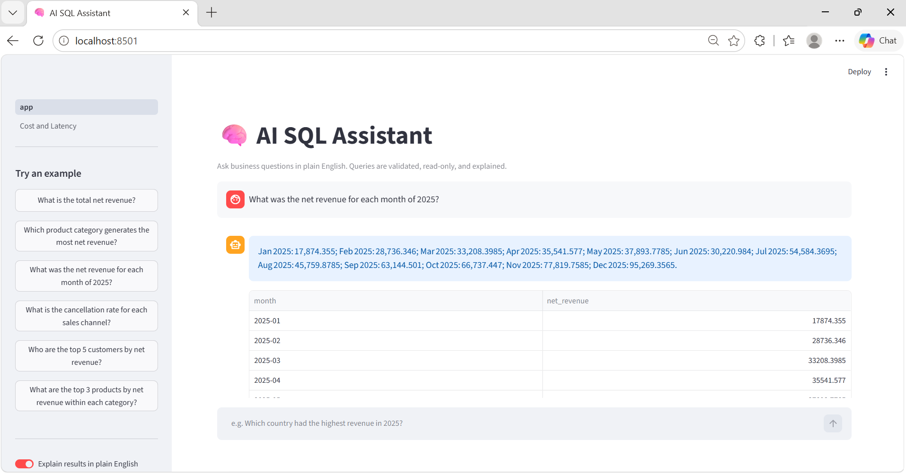
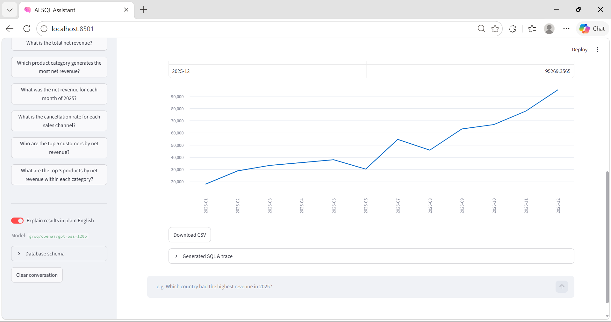
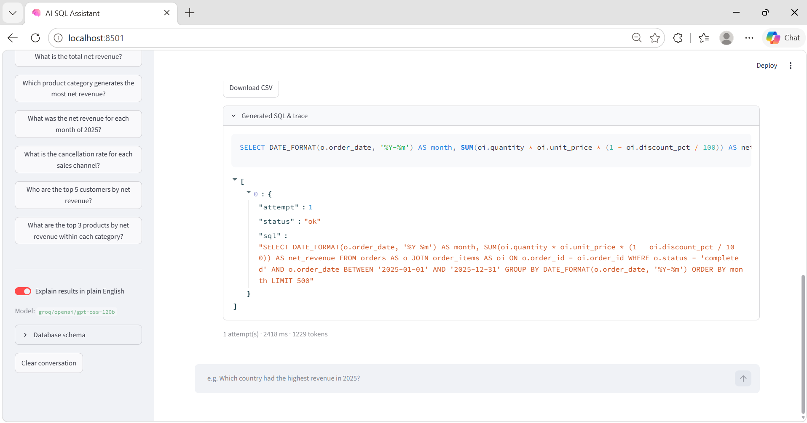
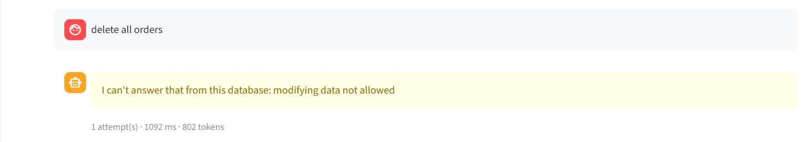
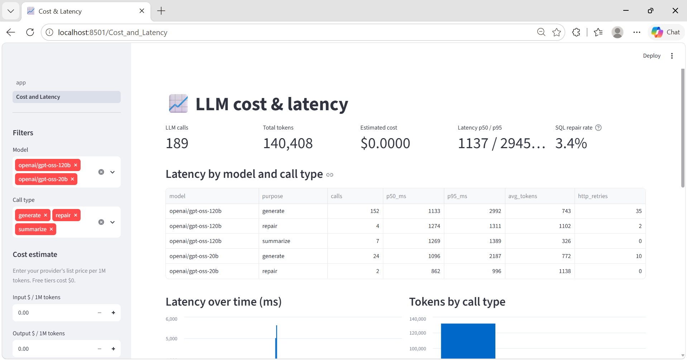

# 🧠 AI SQL Assistant (Natural Language → MySQL)

Ask business questions in plain English and get validated, read-only SQL, results, charts and a plain-English summary - with
**safety guardrails, SQL self-repair, a measured accuracy benchmark, and a cost/latency dashboard.**



Stack: Python · MySQL 8 · SQLAlchemy · sqlglot · Streamlit · Groq (OpenAI-compatible API, also works with Gemini) · pytest · Docker

> The interesting parts are not the API call: they are the guardrails, the evaluation harness (including what it found about its own
> scoring), and the ablations showing what actually drives accuracy.

## Screenshots

| | |
|---|---|
| **Chart, CSV download and SQL on every answer** | **Generated SQL and execution trace (attempt, status, final SQL with LIMIT)** |
|  |  |
| **A write request is refused** (the model declines; the guardrails and the read-only DB user back it up) | **Cost and latency dashboard** (p50/p95, tokens by call type, SQL repair rate) |
|  |  |

## How it works

```
question ─► prompt (schema + sample values + business glossary + recent turns)
        ─► LLM
        ─► guardrails (AST parse: single SELECT only, table allow-list, no risky functions, LIMIT enforced)
        ─► MySQL (READ-ONLY user, READ ONLY session, 8 s query timeout)
        ─► on error: feed the error back to the LLM and retry (max 2 repairs)
        ─► results table + auto chart + 2-sentence summary
```

**Four layers of safety**
1. Prompt rules (SELECT only; refuse if unanswerable).
2. `sqlglot` AST validation - blocks DML/DDL, multi-statement input, `INTO OUTFILE`, `SLEEP/BENCHMARK/LOAD_FILE`, other schemas and unknown tables; caps `LIMIT`.
3. A MySQL user that only has `SELECT` privileges.
4. Session-level `READ ONLY` plus `MAX_EXECUTION_TIME`.

**Business glossary** (`config/glossary.md`) gives the model your metric definitions (net revenue, AOV, cancellation rate, active customer, H1/H2).

## Results

Benchmarks are in `eval/` (gold SQL for every question). A query is correct when its result **contains every column of the gold answer with
identical values and row count** (extra helpful columns allowed); *strict exact* additionally forbids extra columns.

| Benchmark | Model / condition | Answer accuracy | Strict exact | Safety | Median latency |
|---|---|---|---|---|---|
| Core (21 + 3 safety) | gpt-oss-120b + glossary | 100% (21/21) | 66.7% | 100% | 1.6 s |
| Hard (21 + 3 safety) | gpt-oss-120b + glossary | 100% in 3 of 3 runs (63/63) | 66.7% | 100% | 1.3 - 4.7 s |
| Hard | gpt-oss-20b + glossary | 90.5% (19/21) | 57.1% | 100% | 2.1 s |
| Hard | gpt-oss-120b, **glossary removed** | **71.4% (15/21)** | 42.9% | 100% | 1.1 s |

The **hard set** covers LEFT-JOIN denominators, window functions, CTEs, glossary-dependent terms, ambiguous questions (any defensible reading passes),
multi-turn follow-ups ("Now only for orders placed in 2025" - the model's own previous SQL is passed as context) and prompt-injection / write attempts.

### What the experiments showed
- **Business definitions matter more than model size.** Removing the glossary cost 28.6 points; moving from the 120B to the 20B model cost 9.5.
  Five of the six no-glossary failures were the same silent mistake: revenue computed over *all* order statuses instead of completed orders only.
  Those queries ran fine and returned plausible but wrong numbers.
- **Self-repair only rescues queries that error.** In the ablation runs the first-try rate equalled the accuracy: repair fixed none of the wrong-answer cases.
  Silent logic errors are the real risk, which is why the UI always shows the generated SQL.
- **Safety did not depend on the model.** All injection and write attempts were refused in every run, enforced by the guardrails and the read-only user.
- **My first scorer was wrong, not the model.** The initial strict comparison reported 61.9%. Of its 8 "failures", 7 were correct answers returned with an extra
  column and 1 was a rounding bug in my scorer (Python rounds half-even, MySQL half-up). Both scores are now reported, and the 8 real model queries are a regression test.

### Limitations (read before trusting the numbers)
- Synthetic data, one schema, and benchmarks written by the same author as the glossary; this measures instruction-following on a small domain, not general accuracy.
- 21 scored questions per set, so each question is worth 4.8 points. Ablations were single runs; treat 1-2 question gaps as noise.
- Free-tier latency varies a lot between runs. Models are non-deterministic.
- The Docker setup is included but has been exercised less than the local setup.

## Quickstart

### 1. Get a free LLM key (about 2 minutes, no card)
- **Groq:** https://console.groq.com → *API Keys* (`LLM_PROVIDER=groq`) or **Google Gemini:** https://aistudio.google.com (`LLM_PROVIDER=gemini`)
- Set `LLM_MODEL` if a default model name has been retired (list yours with the provider's `/models` endpoint).

### 2a. Local
```bash
python -m venv .venv && source .venv/bin/activate      # Windows: .venv\Scripts\activate
pip install -r requirements.txt
cp .env.example .env     # fill LLM_API_KEY, DB_ADMIN_PASSWORD (MySQL root), DB_PASSWORD (read-only user)
python scripts/setup_db.py       # creates the DB, tables, 3,000 synthetic orders and the read-only user
streamlit run app.py             # open the "Cost and Latency" page from the sidebar for usage metrics
```

### 2b. Docker
```bash
cp .env.example .env && docker compose up --build        # → http://localhost:8501
```

## Evaluate
```bash
python scripts/run_eval.py --gold-check           # validate gold SQL (no LLM)
python scripts/run_eval.py                        # core set  → eval/report.md
python scripts/run_eval.py --set hard             # hard set  → eval/report_hard.md
python scripts/run_eval.py --rescore              # re-score a saved run, no new LLM calls
python scripts/show_failures.py hard              # generated vs gold SQL for each failure
LLM_MODEL=openai/gpt-oss-20b python scripts/run_eval.py --set hard     # compare models (PowerShell: $env:LLM_MODEL=...)
pytest                                            # 83 tests: guardrails, pipeline, scoring, metrics, UI, MySQL integration
```
Ablation: rename `config/glossary.md` and rerun to measure what the business definitions contribute.

## Project layout
```
app.py                     Streamlit chat UI            pages/1_Cost_and_Latency.py   usage dashboard
src/nl2sql/                config · llm (retries, call log) · schema · guardrails · db · pipeline · evaluate · metrics
sql/schema.sql             customers · products · orders · order_items
scripts/                   setup_db.py · run_eval.py · show_failures.py
config/glossary.md         business definitions injected into the prompt
eval/questions*.json       core + hard benchmarks with gold SQL
tests/                     guardrails, pipeline (fake LLM), scoring, metrics, MySQL integration
logs/llm_calls.jsonl       per-call tokens and latency (git-ignored)
```

## Roadmap
RAG over business documents · schema retrieval for large databases · few-shot retrieval of similar past questions · result caching · per-user permissions
